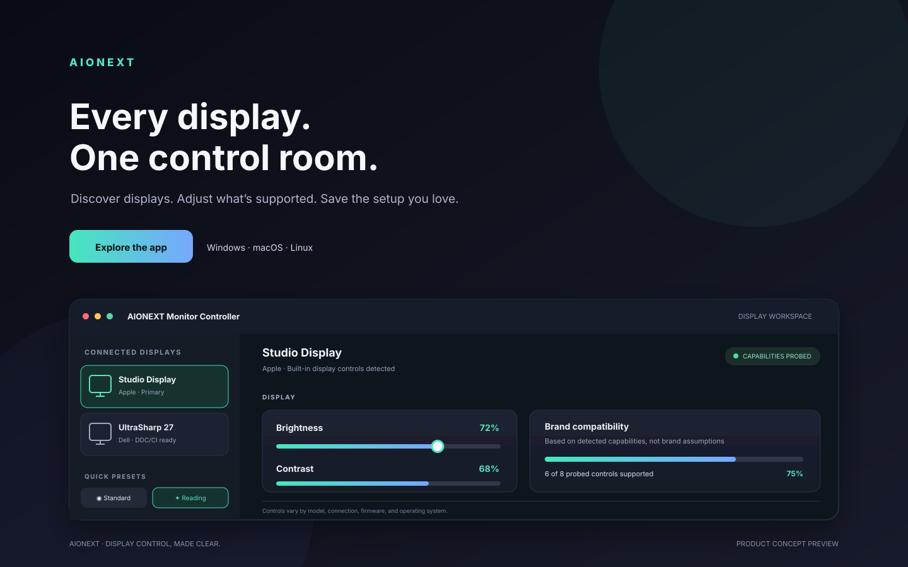

# AIONEXT Monitor Controller

**Every display. One control room.**

Discover connected displays, adjust the controls your hardware actually exposes, and save a setup that feels right. AIONEXT Monitor Controller brings monitor discovery, supported DDC/CI controls, quick presets, and reusable calibration profiles into one focused desktop app.



[](https://github.com/AIONEXT/monitor-controller/actions/workflows/build-and-release.yml)
[](https://github.com/AIONEXT/monitor-controller/releases)
[](LICENSE)

> AIONEXT Monitor Controller is an independent utility and is not affiliated with or endorsed by monitor manufacturers. Brand identification is for organization only; available controls depend on the display, connection, operating system, and hardware probe results.

## Your displays, in sync with your workflow

- **See what’s connected.** Discover displays and view manufacturer/model details when the OS and hardware expose them.
- **Tune what’s supported.** Adjust probed controls such as brightness, contrast, color, input, and audio where available.
- **Set the scene.** Apply practical presets; only controls detected as supported and writable are included.
- **Keep your calibration.** Save profiles locally and import/export JSON backups.
- **Know what works.** Review capability coverage based on probe results—not assumptions based on a logo.
- **Stay in control.** Display communication happens locally through the platform backend.

### Brand-aware, with honest compatibility

Brand recognition covers common manufacturers and families, including Acer, AOC, Apple, ASUS, BenQ, Dell, EIZO, Gigabyte, HP, Huawei, Lenovo, LG, MSI, Philips, Samsung, Sharp, and ViewSonic. This helps identify and organize monitors; it does **not** promise every feature on every model.

## Get the app

Visit [GitHub Releases](https://github.com/AIONEXT/monitor-controller/releases) and choose an artifact that matches your operating system and architecture. Asset names and formats may vary between releases; use the notes attached to that release for exact download and installation details. No published release yet? Build from source below.

## Platform support

| Platform | Discovery | Controls in the current backend |
|---|---|---|
| Windows 10/11 | WMI monitor discovery where metadata is exposed | Built-in brightness where Windows WMI brightness methods are available; general external-monitor DDC/CI is not claimed |
| Linux | `ddcutil` display discovery and VCP probing | Positively probed VCP controls through `ddcutil`, subject to DDC/CI and I²C permissions |
| macOS 11+ | Display metadata via `system_profiler` when available | No writable DDC/CI controls in the current backend |

**Getting no controls?** Enable DDC/CI in the monitor’s on-screen menu, use a direct HDMI/DisplayPort/USB-C connection if possible, and check whether a dock, KVM, adapter, or graphics driver blocks communication. Capability support varies by model and firmware. Do not rely on controls that the app does not show as supported.

### Linux setup

Install `ddcutil` with your distribution’s package manager and follow its current documentation for I²C permissions. Some systems require the `i2c-dev` kernel module and access to the relevant I²C device. Re-login after changing group permissions. Avoid running the desktop app as root unless your distribution’s security guidance requires it.

## Build and run

**Prerequisites:** Node.js 20+ and npm 10+. Native packaging dependencies vary by OS; Linux may require GTK, NSS, libsecret, and build tools.

```bash
git clone https://github.com/AIONEXT/monitor-controller.git
cd monitor-controller
npm ci
npm run icons
npm run typecheck
npm run lint
npm start
```

Create local distributables with:

```bash
npm run package  # unpacked application
npm run make     # Electron Forge makers configured for the current platform
```

Build on a matching OS/architecture for reliable native packaging. Code signing and notarization require platform-specific credentials; a successful local build does not imply a signed release.

## Profiles, privacy, and data

Monitor profiles and schedules, enterprise configuration, and bounded audit history are stored locally under Electron’s `userData/enterprise` directory. Calibration profiles are stored in renderer local storage; use JSON export to back them up or transfer them. Review exported files before sharing, since profiles may contain monitor setting values.

## Contributing and support

- Report bugs and feature requests in [GitHub Issues](https://github.com/AIONEXT/monitor-controller/issues). Include OS/version, monitor model, connection path, and detected controls; redact serial numbers and personal information.
- See [CONTRIBUTING.md](CONTRIBUTING.md) for development and pull request guidance.
- See [docs/RELEASE-CHECKLIST.md](docs/RELEASE-CHECKLIST.md) before publishing a release.

## License

MIT. See [LICENSE](LICENSE).
