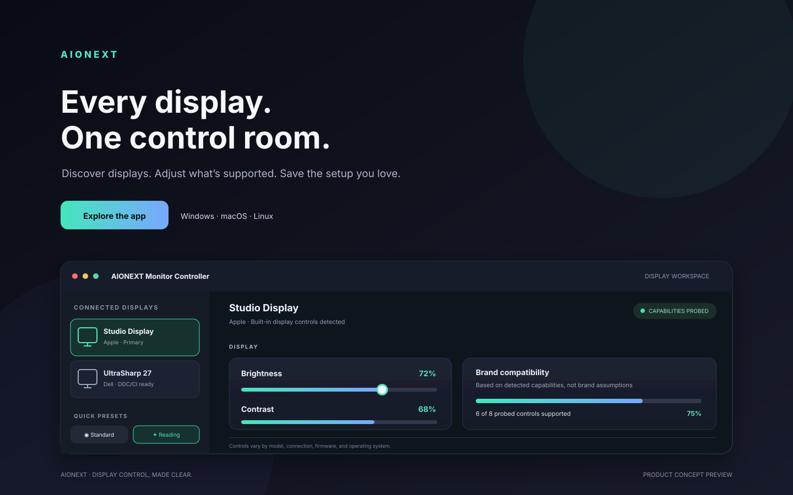

# AIONEXT Monitor Controller

**Every display. One control room.**

Discover displays. Adjust what’s supported. Save the setup you love.

This concept preview is a designed product visualization, not a screenshot of the current application. UI details and values are illustrative; actual capabilities vary by operating system and connected hardware.

## Landing page structure

1. **Hero:** tagline, one-sentence value proposition, release/download action, supported-platform note.
2. **Product visual:** app preview with a caption that makes clear if it is conceptual.
3. **Three value cards:** discover displays; adjust supported controls; save and reuse profiles.
4. **Trust section:** explain that capabilities are probed, platform-specific limitations are explicit, and brand identification is not a guarantee.
5. **Compatibility section:** link to the current platform matrix in the README.
6. **Action footer:** GitHub Releases and source/contribution links.

## Short copy options

- **Every display. One control room.** (recommended)
- **Your displays, tuned your way.**
- **Display control, made clear.**

## Image use

The SVG in `assets/aionext-product-preview.svg` is a custom conceptual mockup for README, release pages, and future landing-page design. Do not represent it as a captured in-app screenshot. Replace it with a real, privacy-reviewed screenshot after product UI and hardware behavior are verified.
